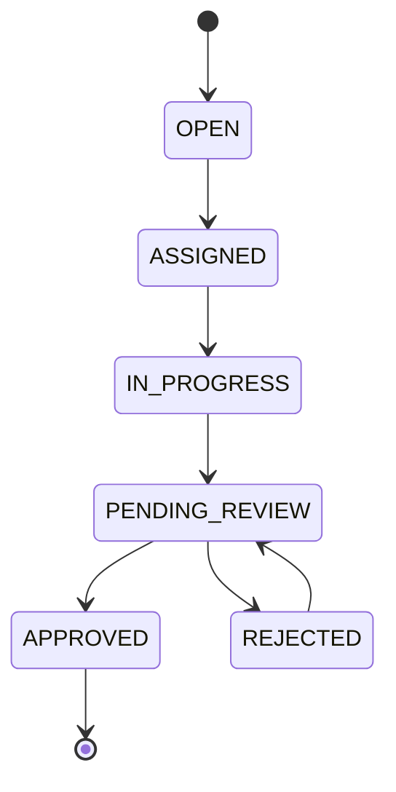

# 03. Ticket lifecycle

## Diagram

## State transition table (source of truth)
Any state transition NOT in the table is rejected by the server with `409 INVALID_STATE_TRANSITION`.

| From | To | Who | Condition | Endpoint | Effect |
|---|---|---|---|---|---|
| (new) | `OPEN` | DISPATCHER | Has valid `deviceName`, `description`, `location`, `slaMinutes` | `POST /tickets` | |
| `OPEN` | `ASSIGNED` | DISPATCHER | Assignee is a `TECHNICIAN`, `isActive`, `isOnDuty` | `POST /tickets/:id/assign` | Send FCM `TICKET_ASSIGNED` |
| `ASSIGNED` | `IN_PROGRESS` | Assigned TECHNICIAN | Server recalculates: distance ≤ `GEOFENCE_RADIUS_M`, `accuracy` ≤ `GPS_MAX_ACCURACY_M` | `POST /tickets/:id/check-in` | Record `checkinAt`, `checkinReceivedAt`, `checkinDistanceM` |
| `IN_PROGRESS` | `PENDING_REVIEW` | Assigned TECHNICIAN | Valid report (enough BEFORE/AFTER photos) | `POST /reports` | |
| `PENDING_REVIEW` | `APPROVED` | DISPATCHER | Current report is `PENDING_REVIEW` | `POST /reports/:id/approve` | Lock the ticket |
| `PENDING_REVIEW` | `REJECTED` | DISPATCHER | `reason` is required | `POST /reports/:id/reject` | Send FCM `TICKET_REJECTED` |
| `REJECTED` | `PENDING_REVIEW` | Assigned TECHNICIAN | Submit a NEW report (`attempt + 1`) | `POST /reports` | |

Notes:
- Redoing work after `REJECTED` needs no new check-in and has no intermediate state: the technician submits a new report directly.
- `APPROVED` is the final state, with no further transitions and no one can edit it (Security Rules + API both block it).
- A technician can have multiple tickets at the same time.
- Every state except `APPROVED` has a way out, so no ticket gets stuck permanently in the normal flow.

## Edge cases and decisions
| Situation | Decision |
|---|---|
| A check-in is sent late (created while offline) and the server finds it outside the zone | `422 OUT_OF_GEOFENCE`. The queue item becomes `FAILED_PERMANENT`, and later items for that ticket are blocked. The ticket stays `ASSIGNED`. The technician must check in again while online and at the right location; photos already taken remain on the device but are marked no longer valid if too old relative to the new check-in (docs/06). |
| Submitting a report twice with the same `clientReportId` | Return the first result (200); do not create a new one. |
| Submitting a report when the ticket is not `IN_PROGRESS`/`REJECTED` | `409 INVALID_STATE_TRANSITION`. |
| Two check-ins with the same `clientEventId` | Return the first result (200). |
| A second check-in (different `clientEventId`) when the ticket is already `IN_PROGRESS` | `409 INVALID_STATE_TRANSITION`. |
| A dispatcher approves/rejects a report already handled by someone else | Use a transaction; the later person receives `409 INVALID_STATE_TRANSITION`. |
| Report is rejected, phone is offline when FCM is sent | FCM may be delayed or lost. The app always re-reads the ticket from Firestore on open/when online, so it still sees `REJECTED` and the reason. |
| FCM send fails during assign/reject | The main operation still succeeds; write a `note` to the event; the API returns `notificationSent: false`. `UNREGISTERED` tokens are removed from `deviceTokens`. |
| Assigning a ticket to someone no longer on duty or deactivated | `422 TECHNICIAN_NOT_ON_DUTY` / `TECHNICIAN_INACTIVE`. |
| A technician "goes missing" while the ticket is `ASSIGNED`/`IN_PROGRESS` | Currently there is no cancel/reassign (out of scope). The web shows an SLA overdue alert (extension below). If cancel/reassign is added later, a conflict policy for late-arriving offline data MUST be added. |

## Extension E1: SLA overdue alert (do after the 4 scenarios)
Runs every minute (node-cron or Cloud Scheduler), selecting tickets that meet ALL conditions:
1. `status` is in {`OPEN`, `ASSIGNED`, `IN_PROGRESS`, `REJECTED`}
2. `now > slaDeadline + SLA_ESCALATION_GRACE_MIN` minutes
3. `escalatedAt == null`

For each ticket, in ONE transaction: re-read it; if `escalatedAt != null` or `status` has changed, skip; otherwise write
`escalatedAt = serverTimestamp()` and add an `ESCALATED` event. Only after the transaction, send FCM (if the dispatcher has registered a token).
The web always shows a real-time alert based on `escalatedAt`, independent of FCM.
Note: a ticket whose work is done but not yet synced (offline) may still be alerted. This is acceptable behavior.